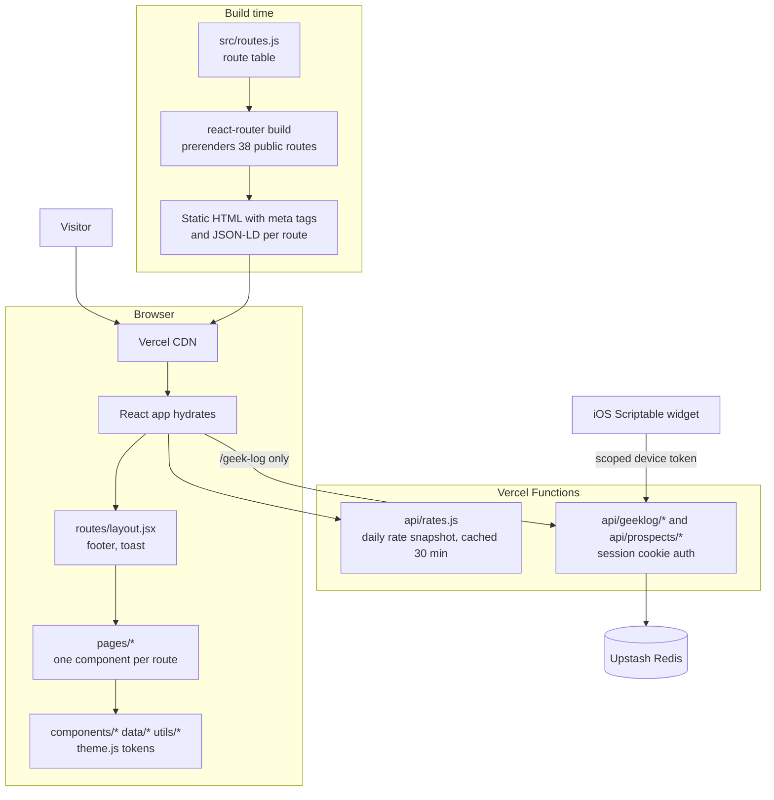

# The Mortgage Geek

[](https://github.com/nickpeters-dev/Mortgage-Geek/actions/workflows/ci.yml)

A mortgage education site and calculator suite for first-time homebuyers, built and run by a working loan officer. It explains the loan process in plain language, gives buyers honest tools to run their own numbers, and turns that trust into inbound leads.

Under the hood, the application combines 38 prerendered public routes, interactive financial simulations, market-data visualizations, serverless APIs, and a private, authenticated prospecting tracker.

**Live site: [mortgagegeek.ai](https://mortgagegeek.ai)**


## What is in it

| Area | What it does | Try it |
| --- | --- | --- |
| Learning Hub | A step-by-step walkthrough of the home loan process, loan programs, costs, and rates | [/learn](https://mortgagegeek.ai/learn) |
| Calculators | Payment calculator, pre-qualification estimate, loan program comparison, cash to close, and rent vs own | [/calculator](https://mortgagegeek.ai/calculator), [/rent-vs-own](https://mortgagegeek.ai/rent-vs-own) |
| Deep Dives | 16 long-form guides on underwriting topics most sites skip: manual underwriting for FHA, VA, and USDA, self-employed income, gift funds, ARMs, seller concessions | [/deep-dives](https://mortgagegeek.ai/deep-dives) |
| Geek Charts | 9 interactive housing market charts: mortgage rates against Treasury yields, payment burden, price to income, homes priced in S&P 500 shares | [/geek-charts](https://mortgagegeek.ai/geek-charts) |
| Geek Log | A private, login-gated tracker for my own production and prospecting, with an iOS home screen widget | Not public |

The Rent vs Own tool is a good sample of the approach. It charges both sides for everything, invests the monthly difference for whichever side spends less, and reports what each would walk away with at the buyer's time horizon.


## Technology stack

| Layer | Choice |
| --- | --- |
| UI | React 18 |
| Routing and build | React Router v7 in framework mode, on Vite 5 |
| Rendering | Static prerender of all 38 public routes at build time (`ssr: false`), with an SPA fallback for the one private route |
| Charts | Recharts |
| Serverless API | Vercel Functions (Node) in `api/` |
| Data store | Upstash Redis, used only by the private Geek Log |
| Hosting | Vercel, with a preview deploy for every branch |
| PWA | Web app manifest and service worker, installable on a phone |
| Styling | A single design token file (`src/theme.js`). No CSS framework. |

The dependency list is short on purpose: nine runtime packages, and nothing gets added without a reason.

## Architecture



How the pieces fit:

- **Routes.** `src/routes.js` is the single route table. Each entry points to a thin adapter in `src/routes/` that re-exports a page component from `src/pages/`.
- **Prerendering.** `react-router.config.js` lists every public path. The build writes real HTML for each one, so search engines and link previews get the full page, title, description, and structured data without running JavaScript.
- **Private route.** `/geek-log` is left out of the prerender list on purpose. It is served by the SPA fallback, marked noindex, and gated by a signed HttpOnly session cookie.
- **Design tokens.** Every color and font comes from `src/theme.js`. Components contain no hardcoded hex values.
- **Calculator math.** Simulation logic lives in plain JS modules (for example `src/components/rentVsOwnSim.js`), separate from the UI, so it can be tested on its own.

```
src/
  root.jsx          document shell, site-wide JSON-LD
  routes.js         route table
  routes/           thin per-route adapters and the layout route
  pages/            one page component per route
  components/       shared UI, charts, calculator and Geek Log pieces
  data/             content, loan programs, tax rates, loan limits
  utils/            helpers
  theme.js          design tokens
api/                Vercel serverless functions
scripts/            parity harness, prerender check, seed script
.github/workflows/  CI
scriptable/         iOS widget source
```

## Local setup

Requires Node 20 or newer.

```sh
git clone https://github.com/nickpeters-dev/Mortgage-Geek.git
cd Mortgage-Geek
npm install
npm run dev        # dev server at http://localhost:5173
```

Other commands:

```sh
npm test           # calculator and Rent vs Own test suites, plus Python parity (needs python3)
npm run build      # production build, prerenders all public routes to build/client
npm run verify     # test, build, and prerender check in one command (what CI runs)
npm run preview    # serve the production build locally
```

The public site needs no environment variables. The private Geek Log and the `api/` functions need Upstash Redis credentials and auth secrets in `.env.local` (`GEEKLOG_KV_REST_API_URL`, `GEEKLOG_KV_REST_API_TOKEN`, `GEEKLOG_KEY`, `GEEKLOG_SESSION_SECRET`, `GEEKLOG_DEVICE_TOKEN`, `GEEKLOG_EXPORT_TOKEN`). To run the functions locally, use `vercel dev`.

## Testing and verification

```sh
npm test           # 146 tests plus the Python parity check (needs python3)
npm run verify     # tests, production build, and prerender check
```

GitHub Actions ([`.github/workflows/ci.yml`](.github/workflows/ci.yml)) runs `npm run verify` on every push to any branch and on every pull request. The badge at the top of this page shows the latest result on `main`.

### What the tests cover

`npm test` runs two suites with Node's built-in test runner, then the parity check.

| Suite | Category | Tests |
| --- | --- | --- |
| Mortgage calculator (78) | Payments and amortization: known answers, schedule totals, extra payment strategies | 14 |
| | Loan program rules: fees, insurance rates, and eligibility for FHA, VA, USDA, and Conventional | 32 |
| | Mortgage insurance end dates | 5 |
| | Full monthly payment, the payment-first solver, and APR | 19 |
| | Valid boundary inputs (0% rate, 15% rate, a $0 loan) and known gaps | 8 |
| Rent vs Own (68) | Edge cases against the Python reference: zero appreciation, rent far below and above the cost of owning, inputs at their limits | 13 |
| | Closed-form scenarios and properties that must hold across every input limit and loan program | 12 |
| | Mortgage insurance timing and yearly amounts | 14 |
| | Agreement with the mortgage calculator's payment | 8 |
| | Input clamping, default checks, and helpers | 21 |

Four of the 146 are marked todo. They record a known gap (the math functions do not re-validate inputs the pages have already checked) so it stays visible in the test output.

No test computes its expected answer with the code it is testing. Payment, schedule, and APR figures come from a separate Python implementation using exact decimal arithmetic ([`tests/reference/`](tests/reference/)). Loan program rules are pinned to dated public sources: HUD Mortgagee Letter 2023-05 for FHA, the va.gov funding fee chart for VA, and the USDA fiscal year 2027 fee notice. The Conventional PMI rates are the site's own estimate, not a regulated figure.

As a check on the tests themselves, I broke the calculator code 21 different ways (a wrong fee, a shifted insurance cutoff, a swapped sign). The suites caught all 21.

### Python parity verification

The Rent vs Own simulation exists twice: the JavaScript the site runs, and an independent Python reference ([`scripts/rent_vs_own_reference.py`](scripts/rent_vs_own_reference.py)). The parity check ([`scripts/rentVsOwnParity.mjs`](scripts/rentVsOwnParity.mjs)) runs both on six fixtures and compares them:

- Owner wealth, renter wealth, loan balance, and side fund at 15 checkpoints across 30 years
- To the dollar on the baseline fixture, within $1 on the other five
- Breakeven year and breakeven band must match exactly

Two implementations written separately are unlikely to share a coding mistake, so agreement is good evidence against arithmetic errors. It is not proof the model is financially right: both versions encode the same assumptions, and those are reviewed by me as a loan officer, not by a test.

### Build checks

| Check | Command | What it catches |
| --- | --- | --- |
| Production build | `npm run build` | Every public route renders in Node without errors. |
| Prerender check | `npm run check:prerender` | All 38 public routes produced static HTML with a title, description, and canonical URL, the private route was not prerendered, and `sitemap.xml` matches. |

### Manually reviewed

- **Every change on a preview.** Each branch gets a Vercel preview deploy. I smoke test the affected routes there before merging.
- **Mortgage content and assumptions.** Program rules, default rates and fees, and regulatory figures are checked against current agency guidelines by me.
- **Dev console.** A clean browser console with no errors on the affected routes.
- **Private API.** The Geek Log endpoints have a written curl test suite ([`geeklog-api-test.md`](geeklog-api-test.md)) that is run by hand after deploys that touch the API.
- **Accessibility.** Color contrast and labels are checked during review against the rules in [`engineering_standards.md`](engineering_standards.md).

### Not yet covered

- **The other calculators.** Pre-qualification, loan comparison, and cash to close have no tests of their own. They share the tested payment and APR math, but their own logic is verified by hand only.
- **Whether the assumptions are right.** The tests confirm the code follows its stated rules. They cannot tell me a rule is the right one for a given borrower. Known simplifications: the mortgage calculator shows FHA and USDA monthly insurance as a level amount (Rent vs Own steps it down each year with the loan balance), and FHA rates for 15-year terms and very large loans are not modeled.
- **Invalid input inside the math functions.** The pages check every input before it reaches the math, and those checks are tested for Rent vs Own. The math functions themselves do not re-check, and that is recorded as a known gap in the test output.
- **UI behavior.** There are no component tests or end-to-end browser tests.
- **Serverless functions.** The API handlers, including authentication, have no automated tests. The rates endpoint parses a third-party page and can break when that page changes.
- **Static analysis.** No linter or type checker is configured.
- **Accessibility and performance.** No automated contrast, axe, or Lighthouse checks in CI.

## How this was built: AI-assisted development

I am a mortgage loan officer, not a career software engineer. I built this site with Claude Code as my engineering partner, and the repository shows how that worked over more than 1,100 commits since April 2026.

**What I brought**

- **The domain.** Every guide, calculator assumption, and underwriting rule on the site comes from years of originating loans. The AI did not decide how FHA manual underwriting works or what a fair rent vs own comparison has to charge each side. I did.
- **The product decisions.** What to build, who it is for, what goes on each page, and what gets cut.
- **The review.** Every change ships to a Vercel preview on its own branch, and I check it there before anything merges to main.

**How I direct the AI**

- **Written standards.** [`CLAUDE.md`](CLAUDE.md) and [`engineering_standards.md`](engineering_standards.md) are the standing instructions the AI reads at the start of every session: architecture, naming and export conventions, SEO requirements, accessibility, and content voice.
- **Inventory before edits.** The AI has to read the relevant files and report what it found before changing anything.
- **Tripwires.** There is a defined list of situations where the AI must stop and ask instead of proceeding: accessibility contrast failures, regulated disclosure wording, trademark use, and anything that reaches outside the task's scope.
- **Verification on every change.** The automated checks, a clean dev console, and a smoke test of the affected routes (see [Testing and verification](#testing-and-verification)). On failure the change is reverted and retried, never patched forward.
- **Independent evidence for math.** I do not take the AI's word that a calculation is right. The Rent vs Own simulation has a separate Python reference implementation, and the two are diffed automatically.

**What that process produced**

The project started as a single `App.jsx` file. It is now a modular React Router v7 app with 38 prerendered public routes, per-route metadata and structured data, a token-based design system, a serverless API with scoped authentication, and an installable PWA. Each of those was a planned migration, done in reviewed steps on a branch, and the commit history shows the sequence.

## Contact

Nick Peters, NMLS #1119524. Reach me through [mortgagegeek.ai](https://mortgagegeek.ai).
