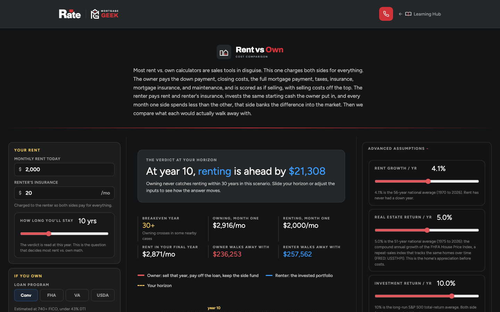
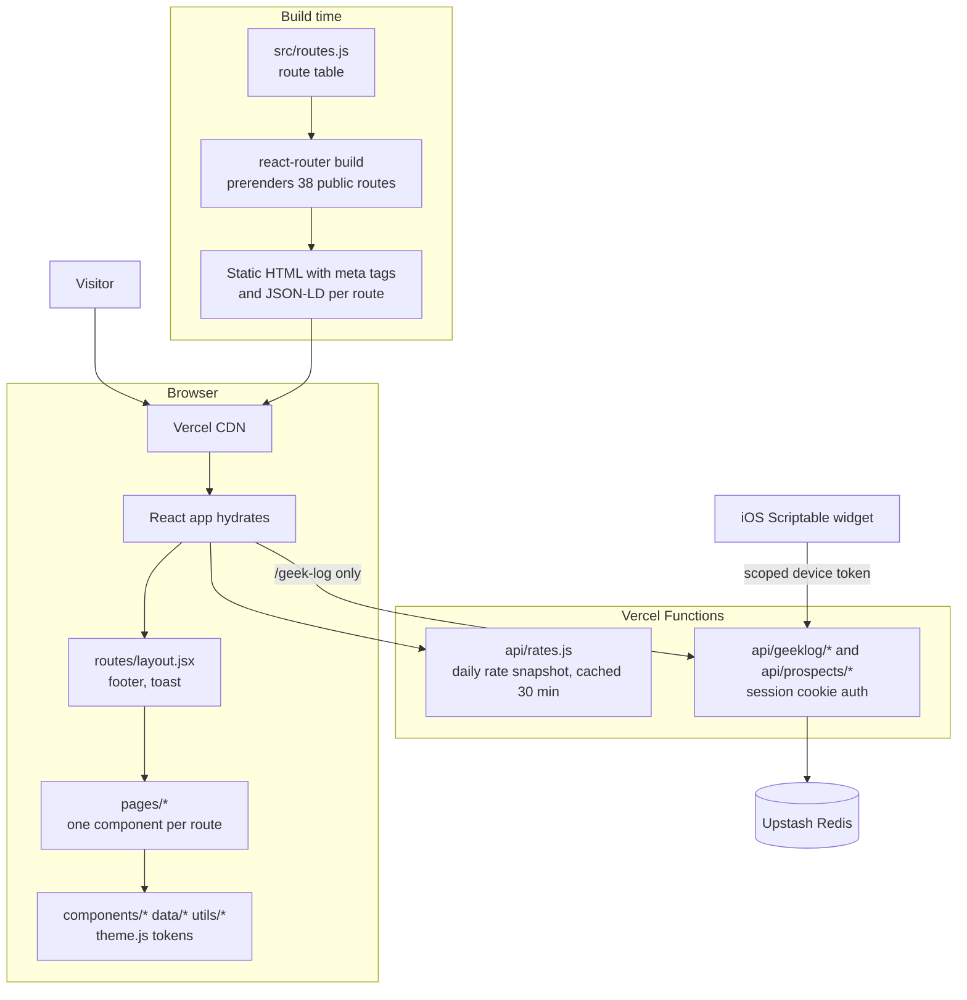

# The Mortgage Geek

A mortgage education site and calculator suite for first-time homebuyers, built and run by a working loan officer. It explains the loan process in plain language, gives buyers honest tools to run their own numbers, and turns that trust into inbound leads.

**Live site: [mortgagegeek.ai](https://mortgagegeek.ai)**


## What is in it

| Area | What it does | Try it |
| --- | --- | --- |
| Learning Hub | A step-by-step walkthrough of the home loan process, loan programs, costs, and rates | [/learn](https://mortgagegeek.ai/learn) |
| Calculators | Payment calculator, pre-qualification estimate, loan program comparison, cash to close, and rent vs own | [/calculator](https://mortgagegeek.ai/calculator), [/rent-vs-own](https://mortgagegeek.ai/rent-vs-own) |
| Deep Dives | 16 long-form guides on underwriting topics most sites skip: manual underwriting for FHA, VA, and USDA, self-employed income, gift funds, ARMs, seller concessions | [/deep-dives](https://mortgagegeek.ai/deep-dives) |
| Geek Charts | 9 interactive housing market charts: mortgage rates against Treasury yields, payment burden, price to income, homes priced in S&P 500 shares | [/geek-charts](https://mortgagegeek.ai/geek-charts) |
| Geek Log | A private, login-gated tracker for my own production and prospecting, with an iOS home screen widget | Not public |

The Rent vs Own tool is a good sample of the approach. It charges both sides for everything, invests the monthly difference for whichever side spends less, and reports what each would walk away with at the buyer's time horizon.



## Technology stack

| Layer | Choice |
| --- | --- |
| UI | React 18 |
| Routing and build | React Router v7 in framework mode, on Vite 5 |
| Rendering | Static prerender of all 38 public routes at build time (`ssr: false`), with an SPA fallback for the one private route |
| Charts | Recharts |
| Serverless API | Vercel Functions (Node) in `api/` |
| Data store | Upstash Redis, used only by the private Geek Log |
| Hosting | Vercel, with a preview deploy for every branch |
| PWA | Web app manifest and service worker, installable on a phone |
| Styling | A single design token file (`src/theme.js`). No CSS framework. |

The dependency list is short on purpose: nine runtime packages, and nothing gets added without a reason.

## Architecture



How the pieces fit:

- **Routes.** `src/routes.js` is the single route table. Each entry points to a thin adapter in `src/routes/` that re-exports a page component from `src/pages/`.
- **Prerendering.** `react-router.config.js` lists every public path. The build writes real HTML for each one, so search engines and link previews get the full page, title, description, and structured data without running JavaScript.
- **Private route.** `/geek-log` is left out of the prerender list on purpose. It is served by the SPA fallback, marked noindex, and gated by a signed HttpOnly session cookie.
- **Design tokens.** Every color and font comes from `src/theme.js`. Components contain no hardcoded hex values.
- **Calculator math.** Simulation logic lives in plain JS modules (for example `src/components/rentVsOwnSim.js`), separate from the UI, so it can be tested on its own.

```
src/
  root.jsx          document shell, site-wide JSON-LD
  routes.js         route table
  routes/           thin per-route adapters and the layout route
  pages/            one page component per route
  components/       shared UI, charts, calculator and Geek Log pieces
  data/             content, loan programs, tax rates, loan limits
  utils/            helpers
  theme.js          design tokens
api/                Vercel serverless functions
scripts/            parity harness and seed scripts
scriptable/         iOS widget source
```

## Local setup

Requires Node 20 or newer.

```sh
git clone https://github.com/nppeters89-stack/Mortgage-Geek.git
cd Mortgage-Geek
npm install
npm run dev        # dev server at http://localhost:5173
```

Other commands:

```sh
npm run build      # production build, prerenders all public routes to build/client
npm run preview    # serve the production build locally
```

The public site needs no environment variables. The private Geek Log and the `api/` functions need Upstash Redis credentials and auth secrets in `.env.local` (`GEEKLOG_KV_REST_API_URL`, `GEEKLOG_KV_REST_API_TOKEN`, `GEEKLOG_KEY`, `GEEKLOG_SESSION_SECRET`, `GEEKLOG_DEVICE_TOKEN`, `GEEKLOG_EXPORT_TOKEN`). To run the functions locally, use `vercel dev`.

To check the Rent vs Own math against its Python reference implementation:

```sh
python3 scripts/rent_vs_own_reference.py > /tmp/rvo_ref.txt
node scripts/rentVsOwnParity.mjs /tmp/rvo_ref.txt
```

## How this was built: AI-assisted development

I am a mortgage loan officer, not a career software engineer. I built this site with Claude Code as my engineering partner, and the repository shows how that worked over more than 1,100 commits since April 2026.

**What I brought**

- **The domain.** Every guide, calculator assumption, and underwriting rule on the site comes from years of originating loans. The AI did not decide how FHA manual underwriting works or what a fair rent vs own comparison has to charge each side. I did.
- **The product decisions.** What to build, who it is for, what goes on each page, and what gets cut.
- **The review.** Every change ships to a Vercel preview on its own branch, and I check it there before anything merges to main.

**How I direct the AI**

- **Written standards.** [`CLAUDE.md`](CLAUDE.md) and [`engineering_standards.md`](engineering_standards.md) are the standing instructions the AI reads at the start of every session: architecture, naming and export conventions, SEO requirements, accessibility, and content voice.
- **Inventory before edits.** The AI has to read the relevant files and report what it found before changing anything.
- **Tripwires.** There is a defined list of situations where the AI must stop and ask instead of proceeding: accessibility contrast failures, regulated disclosure wording, trademark use, and anything that reaches outside the task's scope.
- **Verification on every change.** A clean production build, a clean dev console, and a smoke test of the affected routes. On failure the change is reverted and retried, never patched forward.
- **Reference implementations for math.** The Rent vs Own simulation has an independent Python version. A parity script diffs the two to the dollar, so a calculator bug cannot hide behind a confident explanation.

**What that process produced**

The project started as a single `App.jsx` file. It is now a modular React Router v7 app with 38 prerendered public routes, per-route metadata and structured data, a token-based design system, a serverless API with scoped authentication, and an installable PWA. Each of those was a planned migration, done in reviewed steps on a branch, and the commit history shows the sequence.

## Contact

Nick Peters, NMLS #1119524. Reach me through [mortgagegeek.ai](https://mortgagegeek.ai).
